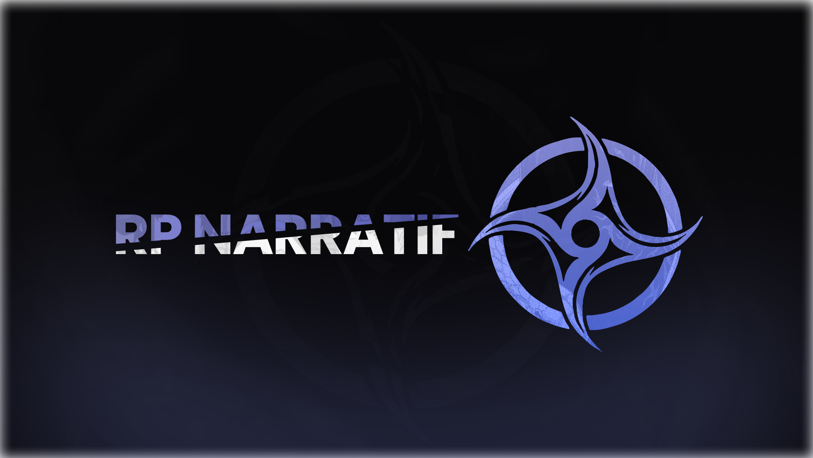

  

    
  

  

    <h2>
      Bienvenue dans l'encyclopédie de
      RP Narratif Naruto Legacy.
    </h2>
    

      Tu trouveras ici les règles du serveur, le lexique RP,
      les informations sur l'univers et les ressources
      nécessaires pour jouer.
    

    

      ✧
    

  

  

    <a class="legacy-card legacy-wide" href="reglement/">
      01
      卷
      <strong>Règlement</strong>
      <small>Les règles et le fonctionnement du serveur</small>
      Explorer la section →
    </a>

    <a class="legacy-card legacy-standard" href="lexique/">
      02
      書
      <strong>Lexique RP</strong>
      <small>Les termes et notions utiles en jeu</small>
      Explorer la section →
    </a>

    <a class="legacy-card legacy-standard" href="univers/">
      03
      渦
      <strong>Univers &amp; Lore</strong>
      <small>L'histoire et les fondations du monde</small>
      Explorer la section →
    </a>

    <a class="legacy-card legacy-wide" href="villages/">
      04
      鳥
      <strong>Villages</strong>
      <small>Les villages et leurs organisations</small>
      Explorer la section →
    </a>

    <a class="legacy-card legacy-small" href="clans/">
      05
      紋
      <strong>Clans</strong>
      <small>Les lignées et leurs particularités</small>
      Explorer la section →
    </a>

    <a class="legacy-card legacy-small" href="combat/techniques/">
      06
      刀
      <strong>Techniques</strong>
      <small>Le répertoire des techniques</small>
      Explorer la section →
    </a>

    <a class="legacy-card legacy-small" href="combat/passifs/">
      07
      六
      <strong>Passifs</strong>
      <small>Les capacités passives</small>
      Explorer la section →
    </a>

    <a class="legacy-card legacy-small" href="univers/chronologie/">
      08
      時
      <strong>Chronologie</strong>
      <small>Les événements et repères historiques</small>
      Explorer la section →
    </a>

  

  

    ⚒
    <strong>Wiki en construction</strong>
    |
    Les rubriques sont déjà organisées.
    Leur contenu sera ajouté progressivement
    à partir du lore et des règles validés par le staff.
  

